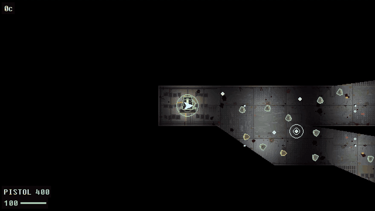

# Non-Euclidean Top Down Shooter

**`necore`**: a non-Euclidean game engine. The world is a graph of convex rooms
joined by portals whose transforms are arbitrary invertible affine maps. There is
no world space anywhere; every coordinate is room-local. Corridors can loop onto
themselves, two wings can occupy the same volume, a wall can be a mirror.

- `engine/necore` — about 20k lines of Rust: room-graph geometry, analytic portal
  visibility, deterministic physics with an event stream, portal raycasts and
  routing. Property-tested, including an oracle test that simulates
  planar-embeddable levels both as a room graph and as flat Euclidean geometry
  and requires the two to agree exactly.
- `engine/necore-py` — PyO3 bindings (module `necore`).
- `game/` — the prototype top-down shooter, level editor and machine-playtest
  harness the engine was built against. The full game it grew into is
  [PERIHELION](https://github.com/sjchilcote/perihelion).



## Running

Requires Python 3.11+, [uv](https://docs.astral.sh/uv/), and a Rust toolchain
(for the engine, built once).

```bash
uv sync
uv run maturin develop --release -m engine/necore-py/Cargo.toml
uv run python -m perihelion            # campaign (The Vigil is on the title menu)
uv run python -m perihelion --level levels/l06.json   # single level
```

Controls: WASD move, mouse aim, LMB fire, 1-8 or wheel to
switch weapons, ESC pause. RMB fires the lightning implant (when found) —
or, with the tau cannon in hand, holds a charge: release to discharge,
hold too long at your peril. The portable hole (slot 8) marks a wall per
click; two marks fold a corridor between them. Mind what fits through.

## Level editor

```bash
uv run python -m perihelion.editor              # new level
uv run python -m perihelion.editor levels/l03.json
```

Full keybinding reference in [EDITOR.md](EDITOR.md).

## Architecture

- `engine/necore` — Rust core: room-graph geometry, analytic portal
  visibility, deterministic physics with an event stream, portal raycasts,
  routing. Property-tested, including an oracle test that checks the
  non-Euclidean machinery against flat Euclidean geometry on levels where
  the two must agree. No world space exists anywhere: every coordinate is
  room-local; only portal transforms relate rooms.
- `engine/necore-py` — PyO3 bindings (module `necore`).
- `game/perihelion` — the game: deterministic `GameSession` (same level +
  seed + inputs ⇒ bit-identical run), immediate-mode lo-fi renderer at
  480×270, data-driven weapons/enemies, procedural audio, campaign.
- `game/perihelion/testkit` — replays, bot players, metrics, perf budgets:
  the game is designed to be playtested by machines (and was).
- `tools/levelgen` — campaign generator. `tools/soundgen` — the SFX bank is
  synthesized from scratch (numpy), verified by an AI listener.
- `levels/` — campaign JSON. See `ENGINE_DESIGN.md` for the full design.

## Development

```bash
./check.sh          # cargo test + rebuild engine + pytest
uv run python tools/playtest/run.py --level levels/l05.json --bot aggro
```

Design constitution: `design_document_2.md` §11. If a change violates an
invariant there, the change is wrong.

## Store copy (draft)

PERIHELION is a top-down survival shooter aboard a station falling into the
sun — one continuous, seamless station whose geometry is not Euclidean:
corridors loop back on themselves, mirror rooms reflect more than light,
and a sixteen-room tesseract deck runs on graph rules no floor plan can
draw. Ten decks stream past with no loading screen between the dock where
you make landfall and the core where it ends. Combat follows the Teleglitch
model — ammunition is scarce, engagements are short, and a mistake in a
corridor is usually the last one you make. The portable hole cuts a doorway
through any wall on command; the Cloister, a safe room folded into the
station's blind spots, is where you go when the hole isn't enough.

The tau cannon fires bolts that bounce off portals the same way they bounce
off walls, so the room layout is part of the loadout. Hard mode makes
everything tougher and meaner; New Game+ starts the fall over with the
arsenal you finished with.

- One seamless non-Euclidean station: mirror wards, infinite corridors, a
  tesseract deck — no loading screens, ever
- Teleglitch-style scarce-ammo survival combat
- Portable hole: cut a doorway through any wall; retreat to the Cloister
- Tau cannon: bolts ricochet off portals
- THE VIGIL: an endless holdout mode on a fold arena
- Hard mode and New Game+
- Level editor included
- Sound design synthesized from scratch, tuned by ear
